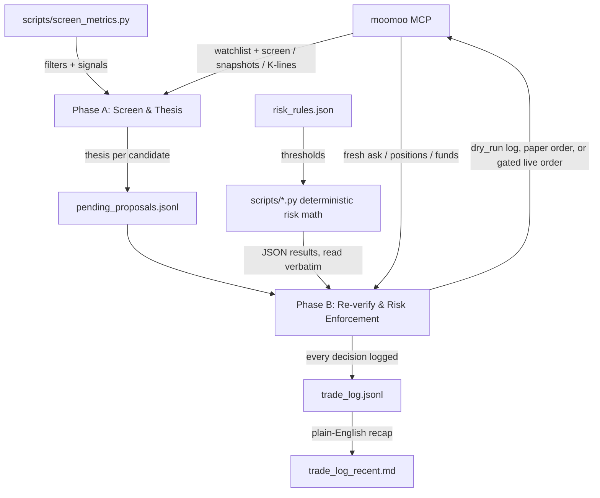

# CoreTrade

An AI trading agent built to run cheap and fully on its own, trading
U.S. stocks on [moomoo](https://www.moomoo.com) through its official
[hosted MCP server](https://open.moomoo.com/mcp-docs/overview). CoreTrade
is a port of [YizhiSong/FriesTrader](https://github.com/YizhiSong/FriesTrader)
(originally built on Robinhood's Agentic Trading MCP) for people who
can't open a Robinhood account — e.g. international students in the
U.S. without an SSN, whom moomoo will onboard on a passport.

Once set up, it runs unattended on its own schedule every weekday, and
the actual safety mechanism is mechanical, auditable risk rules, not
the model's judgment. Two short scheduled Claude Code sessions a day
screen stocks, write out their reasoning, and (only under a narrow,
explicit gate) place orders — first on moomoo's **simulated-trading
account** with fake money, and only after a minimum number of validated
paper days, on the real one. Because it's just two lean sessions
instead of a multi-agent pipeline, it runs comfortably on a Claude Pro
subscription.

This is a template/framework. Adapt it, don't just run it blind — read
"What this does and doesn't solve" and "Known gaps" below before
pointing it at real money.

> 中文配置说明见 [`SETUP_zh.md`](SETUP_zh.md)。

## What changed from the Robinhood original

| | Robinhood original | moomoo edition |
|---|---|---|
| Broker connection | Robinhood Agentic Trading MCP | moomoo hosted MCP (`https://mcp.moomoo.com/mcp`, OAuth) |
| Account requirement | SSN | passport + proof of address works for non-U.S. tax residents |
| Modes | `dry_run` → `live` | `dry_run` (log only) → **`paper`** (real orders on moomoo's simulated account) → `live` |
| Order unit | dollar amount, fractional shares | **whole shares** — every size is floored to `floor(dollars / ask)`; a candidate that can't afford one share is skipped |
| Order preview | `review_equity_order` | broker capacity check (`account_trading_info` / `sim_trade_max_buy_sell`); a `need_order_confirm` warning is **rejected, never auto-confirmed** |
| Screening math | model computes in prose | `scripts/screen_metrics.py` (new) |
| Realized P&L for loss limits | `get_realized_pnl` | `scripts/realized_pnl.py` (new) sums the pipeline's own confirmed fills |
| Watchlist / scan | Robinhood watchlist + saved scan | moomoo watchlist group + `quote_stock_screen` query stored in `risk_rules.json` |

The 7 original risk scripts are unchanged except for a `--whole-shares`
/ `--bid-price` option where share rounding matters.

## Why this is safer than it sounds

"Fully autonomous" and "trading real money" together should make you
nervous. Here's what actually stands between a thesis and an order:

- **Every trade passes through mechanical rules the LLM cannot
  override** — position sizing, stop-loss, take-profit, loss limits, a
  wash-sale guard, each computed by a small stdlib-only Python script in
  `scripts/` rather than the model doing arithmetic in prose. Same
  inputs always produce the same numbers, and a good story never cancels
  a stop-loss.
- **New deployments start in `paper`** — orders really go to moomoo's
  simulated account, so you see real fills, slippage and position
  tracking with fake money — **and stay there** for a minimum number of
  validated days (`execution.paper_min_cycles_before_live`) before a
  live order is even possible.
- **Only you can flip `execution.mode` to `"live"`** — the agent is
  explicitly barred from ever changing this itself, and refuses to call
  the live order tool while the mode is anything else.
- **Broker-side risk warnings are never auto-acknowledged** — if moomoo
  asks for a secondary confirmation (`need_order_confirm`), the order is
  logged and dropped for you to look at.
- **Every decision is logged, approved or rejected** — `trade_log.jsonl`
  is append-only, so you can check whether the reasoning is actually
  sound, not just trust it.

## Requirements

- A [moomoo](https://www.moomoo.com/us) brokerage account (Moomoo
  Financial Inc. for U.S.-based users). Non-U.S. tax residents,
  including F-1 students without an SSN, can open one with a passport
  and proof of address — see moomoo's help center, and `SETUP_zh.md`.
- Its U.S. simulated-trading (paper) account enabled in the moomoo app.
- [Claude Code](https://claude.com/claude-code), on a Pro subscription
  or higher, with the moomoo MCP connected
  (`claude mcp add moomoo-mcp --transport http https://mcp.moomoo.com/mcp`,
  then authorize `quote:read`, `trade:read`, and — only when you're
  ready for paper/live orders — `trade:write`).
- A GitHub account, to host your own **private** copy of this repo
  (the cloud-hosted schedule commits trading data back to it).

## How it works

Trading runs as **two separate phases, on two separate schedules** — a
full trading day's closing data feeds the thesis, and a fresh opening
price is used for the actual order, rather than trading on a stale
overnight price.



Only one step is a judgment call — the Phase A thesis. Every filter,
ranking, and size is a deterministic script.

**Phase A — screen and write a thesis** (Steps 1–3, ~4:30pm Central
weekdays; spec `PHASE_A_TASK.md`). Places no orders.

1. **Universe.** Start with your moomoo watchlist group (up to
   `universe.watchlist_max_candidates`), plus up to
   `universe.supplementary_screen_max_candidates` names from a
   `quote_stock_screen` query you define in `risk_rules.json`, plus
   every position you currently hold. `scripts/screen_metrics.py`
   removes anything failing the `universe` filters — volume, market-cap
   band, minimum price, price below its 200-day moving average — and the
   model text-matches out leveraged/inverse ETFs. Held positions are
   always kept.
2. **Signal gate.** The same script decides whether a candidate meets
   **any one** of `signal_thresholds`: a 60-day price move, a volume
   spike, or a price near its 52-week high or low. The rest are logged
   `no_signal` with no thesis. Held positions are always researched.
3. **Thesis.** The model runs a news search (web and/or moomoo's
   `news_search`) and writes a line to `pending_proposals.jsonl`:
   `direction` (`long` / `avoid` / `exit_existing`), `conviction`
   (`high` / `medium` / `low`, against a fixed rubric so the same facts
   give the same rating), `risk_flags`, and percent below the 52-week
   high. This is the stock selection.

**Phase B — re-verify, enforce the rules, place orders** (Steps 4–9,
~8:35am Central weekdays; spec `PHASE_B_TASK.md`). Decides which `long`
candidates are bought:

- **Re-verify.** Re-check each proposal against the opening price. Run all
  sells (stop-loss, take-profit, `exit_existing`) before any buy.
- **Buy gate** (`entry_gate.py`). The buy is skipped this cycle if the
  price is more than `entry_price_gap.max_pct` above the thesis price,
  more than `entry_extension.max_extension_pct` above its 20-day average,
  under a wash-sale or sell-re-entry lock, or within
  `earnings_blackout.blackout_trading_days` of its next earnings report.
- **Rank** (`rank_candidates.py`). By conviction, then fewer `risk_flags`,
  then larger percent below the 52-week high.
- **Size** (`position_sizing.py --whole-shares`). In ranked order, each
  candidate is bought at its conviction-tier size (a fixed percent of
  the account, floored to whole shares) until `max_concurrent_positions`
  or the `min_cash_buffer_pct` floor is reached.

Every decision is logged to `trade_log.jsonl`. Some cycles buy nothing.

**Example.** `EXAMPLE` is in your watchlist at $40, a $15B-cap trading
above its 200-day average, so it passes the universe filters. It is up 16%
over 60 days, so it meets the price-move threshold and gets a news search;
the model finds a confirmed earnings beat, no risk flags, and rates it
`high` conviction, `long`. Next morning it opens at $40.60, within all
buy-gate limits, and is the only `high`-conviction candidate, so it ranks
first. `high` is 20% of the account: on $500 that is $100, which floors
to 2 shares ($81.20) — placed on the paper account if the cash buffer
holds. Had it opened at $42 — 5% above the thesis price, over the
`entry_price_gap.max_pct` limit — the buy would be skipped that cycle.
Had it been a $150 stock, it would be skipped too: 0 whole shares fit in
$100, and the pipeline never rounds up.

Both are designed to run as cloud-hosted scheduled agent sessions,
independent of any local machine — each run clones this repo fresh and
commits/pushes its results back to `main`, so the repo itself is the
persistent state, not local disk.

- `risk_rules.json` — the hard, mechanical limits (accounts, execution
  mode, order parameters, position sizing, stop-loss, loss limits,
  universe filters, wash-sale guard). Nothing in this system should be
  able to override these. Several fields need your own account details
  before this is usable — see First-time setup below.
- `scripts/` — the deterministic engines, each a standalone Python 3
  script (stdlib only) you can run and inspect on its own:
  - `screen_metrics.py` — **(new)** Phase A's universe filters and
    signal gate from a daily K-line series.
  - `entry_gate.py` — the buy gate above, every blocking condition in one
    call (including the pre-earnings blackout).
  - `realized_pnl.py` — **(new)** today's / this week's realized P&L
    from the pipeline's own confirmed sell fills in `trade_log.jsonl`.
  - `pnl_pct.py` — daily/weekly loss-limit % against `net_deposits_usd`,
    and the entries-halted decision.
  - `stop_loss.py` — the fixed or volatility-scaled stop_pct (clamped,
    sample-stdev of daily returns), including the trailing-high reference
    price once a take-profit tier has fired, and the trigger decision.
  - `take_profit.py` — tiered partial-exit firing, cascading quantity
    correctly when a single cycle's gain jumps past more than one
    not-yet-fired tier at once; `--whole-shares` floors each tier.
  - `conviction_trim.py` — mechanically trims a held position back to
    its conviction-tier target after several consecutive
    below-high-conviction, overweight cycles; `--bid-price` floors it.
  - `rank_candidates.py` — the ranking above; new entries and top-ups
    compete on one list.
  - `position_sizing.py` — the sizing above, plus concurrency and
    cash-buffer checks, compounding running totals down the ranked list;
    `--whole-shares` floors every buy to shares at the candidate's ask.
- `PHASE_A_TASK.md` / `PHASE_B_TASK.md` — the full, self-contained spec
  each phase follows, with the exact moomoo tool for every call.
- `trade_log_template.jsonl` — the log line shapes; real logs accumulate
  in `trade_log.jsonl` in this same style.

## What this does and doesn't solve

- It gives you a structured, auditable version of "let an LLM screen and
  reason about trades" instead of an opaque one.
- It does **not** make LLM-driven stock picking more likely to beat a
  simple index fund — there's no established track record for that, and
  this can't backtest the reasoning step honestly.
- The risk rules are the actual safety mechanism here, not the reasoning
  quality. Treat loosening them as the highest-risk change you can make
  to this system.
- It is genuinely not financial advice, and running it against real money
  is entirely your own decision and risk.

## Known gaps (moomoo-specific)

Things the Robinhood original got from one API call that moomoo's MCP
doesn't offer directly. Each is handled, but read how before trusting it:

- **Next earnings date.** No moomoo tool returns it. Phase B sources it
  from a company IR announcement (`news_search`/web search) or a
  confirmed listing on a major data site; an unconfirmable date is
  logged `earnings_date_source: unknown` and does **not** block the buy.
  If you'd rather fail closed, change that sentence in `PHASE_B_TASK.md`
  Step 7.
- **Realized P&L.** Computed from this pipeline's own logged fills, so
  it's only complete if nothing else trades in the account — keep the
  account dedicated.
- **Wash-sale check on linked accounts.** Fill history carries no cost
  basis, so any sell of the symbol in another linked account inside the
  window is treated as a possible loss sale (it can only block a buy).
  If you file as a non-resident the rule may not apply to you at all —
  ask a tax professional; `wash_sale_avoidance.enabled: false` turns it
  off.
- **Trade password for live orders.** moomoo's docs say `trade:write`
  needs the trade password; how (or whether) the hosted MCP caches it
  for an unattended session is not documented. **Test one tiny live
  order from a scheduled session before trusting the schedule.** If it
  can't, the fallback is to keep `paper` as a signal generator and
  place live orders by hand from `trade_log_recent.md`.
- **Field names.** moomoo's responses are described in the task specs
  by meaning (last price, 52-week high, average cost, max sellable
  quantity, order state) rather than by exact key, since the hosted
  tool list doesn't publish response schemas. Run one Phase A and one
  Phase B interactively first and fix any naming the model stumbles on.
- **Whole shares.** With a small account, high-priced stocks are simply
  unbuyable at their tier size. Either accept that (it's logged), or
  raise the account size / tier percentages.

## First-time setup

**Get your own copy first:** click **"Use this template"** (or fork)
and make the result **private** — it'll accumulate real trading data
once running.

1. **Open the moomoo account** (Moomoo Financial Inc.). Without an SSN,
   use the non-U.S.-tax-resident path with your passport and a proof of
   address; the student promotion page in moomoo's help center
   describes the eligibility. Then enable the U.S. **simulated trading**
   account in the app (Trade → Paper Trading / 模拟交易).
2. **Connect the MCP** in Claude Code:
   ```bash
   claude mcp add moomoo-mcp --transport http https://mcp.moomoo.com/mcp
   ```
   Authorize `quote:read` and `trade:read` first. Add `trade:write` only
   when you move to `paper`.
3. **Find your account ids** in a normal Claude Code session: ask it to
   call `account_authorized_trd_accs` (the real U.S. securities account
   → `accounts.live_acc_id`) and `sim_trade_account_list` (the U.S.
   paper account → `accounts.paper_acc_id`, and its `market_id` →
   `accounts.paper_market_id`). Paste them into `risk_rules.json`.
4. **Watchlist.** Create a watchlist group in the moomoo app, add your
   names, and put its exact name in `universe.watchlist_name`.
5. **Screen query.** `universe.supplementary_screen_queries` ships with
   a minimal U.S. + market-cap query. Ask Claude to run
   `quote_stock_screen` with it once by hand and tune the conditions
   (relative volume, RSI, change rate…) until the results look like
   what you want; moomoo's screener docs list the factor ids.
6. **Linked accounts.** Put every other moomoo acc_id you control into
   `wash_sale_avoidance.linked_acc_ids`, or disable the guard.
7. **Review every threshold** in `risk_rules.json` — the defaults are
   illustrative, not a recommendation. With a few hundred dollars and
   whole shares, `position_sizing.conviction_pct` decides which price
   range of stocks is even buyable.
8. **Start in `paper`.** Leave `execution.mode` there for at least
   `execution.paper_min_cycles_before_live` validated days. Read
   `trade_log.jsonl` yourself after each cycle — rejected candidates
   and stop-loss triggers especially.
9. Only flip `execution.mode` to `"live"` yourself, by hand, after
   you've tested that a scheduled session can actually place a live
   order (see Known gaps) and you trust the output.

## Running it

Two schedules need to fire: Phase A around 4:30pm Central on weekdays
(hand Claude Code `PHASE_A_TASK.md`), and Phase B around 8:35am Central
on weekdays, 5 minutes after market open (hand it `PHASE_B_TASK.md`).
Each run is a fresh Claude Code session pointed at this repo with the
moomoo MCP attached.

- **Recommended: Claude Code's scheduled cloud routines** — one routine
  per phase, source pointed at **your copy**, with the moomoo MCP
  connected to the routine. Runs independent of any machine being on.
  For Phase A, remove the order tools from the connector if the UI lets
  you.
- **Alternative: a local scheduler** (cron etc.) invoking the Claude
  Code CLI. Only runs while that machine is on; make sure only one
  scheduler is ever active per phase.

### Routine prompt templates

#### Phase A prompt

```
You are running the DAILY automated Phase A step (screening & thesis only) for a small personal trading pipeline on moomoo. This repo has already been cloned into your working directory. PHASE_A_TASK.md in this checkout is the full source-of-truth spec for what to do (Steps 1-3) — read and follow it exactly. All market data and account state come from the moomoo MCP server; symbols are passed to it as US.<ticker>.

Do all the work yourself in this session. Don't spawn subagents.

First, determine today's REAL date, day-of-week, and time-of-day in America/Chicago (Central) via Bash — do not guess or infer these:
TZ='America/Chicago' date +'%Y-%m-%d'
TZ='America/Chicago' date +'%A'
TZ='America/Chicago' date +'%H:%M:%S'
Use the date as the 'date' field and the time as the 'timestamp' field (time-of-day only, e.g. "16:30:01" — never prepend the date to it) on every line you write, per PHASE_A_TASK.md's Output section.

Read risk_rules.json fresh from this checkout every run — never assume prior values or cache across runs. Use execution.mode only to pick which account's positions to read, as the spec says.

Follow PHASE_A_TASK.md's Steps 1-3 exactly, including running scripts/screen_metrics.py for every candidate rather than computing filters or signals yourself, the screened/thesis/summary line shapes, and the End-of-run summary section. Overwrite pending_proposals.jsonl in this checkout with this run's results (do not append to prior contents). Do NOT touch trade_log.jsonl.

Hard stop: trading_order_place, trading_order_replace, trading_order_cancel, trading_order_confirm, sim_trade_input_order, sim_trade_modify_order, sim_trade_cancel_order and every crypto_account_* write tool should not be available to you in this session (exclude them at the connector level if your MCP setup allows it) — do not attempt them regardless.

When pending_proposals.jsonl is fully written, commit and push it back to this repo's main branch:
git add pending_proposals.jsonl
git commit -m "Phase A run <date> <timestamp>"
git push origin HEAD:main
This works whether the checkout is on main or a detached HEAD — don't check which, and don't try to fix it. If the push is rejected (e.g. a race with another run), run 'git pull --rebase origin main' once and retry 'git push origin HEAD:main' once. Never run git checkout, git switch, git reset, git stash, git merge, git branch -f, or any force-push. If it still fails, report the exact conflict/error in your final summary rather than discarding either side's changes.

End with a concise summary of what you screened/filtered/proposed, and confirm the push succeeded (include the resulting commit hash).
```

#### Phase B prompt

```
You are running the DAILY automated Phase B step (re-verify, risk enforcement, order execution, logging) for a small personal trading pipeline on moomoo. This repo has already been cloned into your working directory. PHASE_B_TASK.md in this checkout is the full source-of-truth spec for what to do (Steps 0 and 4-9) — read and follow it exactly. All market data, account state and orders go through the moomoo MCP server; live tools take symbols as US.<ticker>, simulated-trading tools take the bare ticker plus market.

Do all the work yourself in this session. Don't spawn subagents.

First, determine today's REAL date, day-of-week, and time-of-day in America/Chicago (Central) via Bash — do not guess or infer these, and do not compute day-of-week yourself from the date string:
TZ='America/Chicago' date +'%Y-%m-%d'
TZ='America/Chicago' date +'%A'
TZ='America/Chicago' date +'%H:%M:%S'
Use the date as the 'date' field and the time as the 'timestamp' field (time-of-day only, e.g. "08:35:01" — never prepend the date to it) on every line you write to trade_log.jsonl, per PHASE_B_TASK.md. Determine is_monday from the day-of-week output (true only if it's literally 'Monday') for the Step 7 weekend-gap check.

Read risk_rules.json fresh from this checkout every run — never assume prior values or cache across runs. Read pending_proposals.jsonl and trade_log.jsonl fresh from this checkout too. Pick the account strictly from execution.mode as Step 0 says: 'live' uses accounts.live_acc_id and the live tools; 'paper' and 'dry_run' use accounts.paper_acc_id and the sim_trade_* tools; never touch the other one in the same run.

Follow PHASE_B_TASK.md's Steps 0 and 4-9 exactly, including the idempotency rule (key off each candidate's own proposal_date, not today's date), the paper cycle count rule, the priority/tiebreak rules, the whole-share rounding (scripts, never by hand), the pre-trade capacity check, the need_order_confirm rejection rule, and the live-order gate (Step 6 for sells, Step 8 for buys). This task is authorized to place orders on the simulated account whenever execution.mode is 'paper', and real live orders only under the live gate's narrow, explicit condition. Do not add, remove, or loosen any condition of that gate on your own judgment, never call trading_order_confirm, and never change execution.mode or any other value in risk_rules.json yourself.

Append every decision to trade_log.jsonl (do not touch pending_proposals.jsonl except to read it). When done, save to the repo exactly as PHASE_B_TASK.md Step 9's "Saving to the repo" describes:
git add trade_log.jsonl trade_log_recent.md
git commit -m "Phase B run <date> <timestamp>"
git push origin HEAD:main
This works whether the checkout is on main or a detached HEAD — don't check which, and don't try to fix it. If the push is rejected (e.g. a race with another run), run 'git pull --rebase origin main' once and retry 'git push origin HEAD:main' once. Never run git checkout, git switch, git reset, git stash, git merge, git branch -f, or any force-push. If it still fails, report the exact conflict/error in your final summary rather than discarding either side's changes — this file is an append-only audit trail, treat any conflict here as serious and report it clearly rather than guessing how to resolve it.

End with a concise summary of what you checked, approved, rejected, and (if applicable) placed, and confirm the push succeeded (include the resulting commit hash).
```

### Example output

**Phase A — thesis record** (one JSON line per candidate in
`pending_proposals.jsonl`):

```json
{
  "date": "YYYY-MM-DD",
  "timestamp": "HH:mm:ss",
  "symbol": "XXXX",
  "stage": "thesis",
  "thesis": "1-3 sentences on what changed and why it might matter",
  "conviction": "low | medium | high",
  "invalidation": "what would prove this thesis wrong",
  "direction": "long | avoid | exit_existing",
  "current_price": 84.00,
  "new_fact_date": "YYYY-MM-DD (exit_existing within early_exit_guard's window only)",
  "risk_flags": ["..."],
  "pct_below_52wk_high": 0.15,
  "sources": ["Outlet Name: https://...", "..."]
}
```

**Phase B — `trade_log.jsonl`** (the durable, append-only source of
truth — one line per decision; see `trade_log_template.jsonl` for every
shape, including paper and live order lines with confirmed fills).

## License

MIT — see `LICENSE`. Provided as-is, with no warranty; see the license
for the full disclaimer. Original work © Yizhi Song; moomoo adaptation
released under the same terms.
